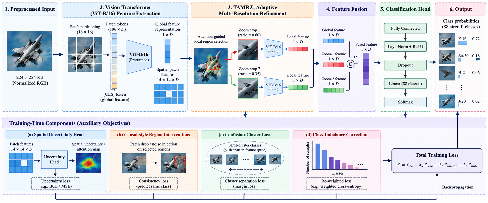

# CUGAR: Causal--Uncertainty Guided Adaptive Refinement for Fine-Grained Military Aircraft Classification

CUGAR is a fine-grained image-classification system for identifying
military aircraft across **88 classes**. It combines a pretrained Vision
Transformer (ViT-B/16) with uncertainty-guided spatial refinement,
multi-scale zoom crops, causal-style image interventions, and
confusion-aware training strategies.

The implementation is provided in `train_jets_cugar_vit_v4.py`. The
reported evaluation summary is stored in `overall_summary(1).json`.

## Architecture

The figure below summarizes the main CUGAR pipeline and its auxiliary training objectives. The auxiliary components are used during training; the prediction path proceeds from ViT feature extraction through multi-resolution refinement, feature fusion, and classification.




## Results

The supplied evaluation summary reports results on **32,029 evaluation
samples**.

  Metric                  Single-pass inference   Test-time augmentation (TTA)
  --------------------- ----------------------- ------------------------------
  Top-1 accuracy                         88.49%                     **89.16%**
  Top-5 accuracy                         93.79%                     **94.34%**
  Hard-class accuracy                    87.76%                     **88.46%**

Additional reported metric:

-   **Macro F1 with TTA:** 0.9025 (90.25%)
-   **Top-1 improvement from TTA:** +0.67 percentage points
-   **Classes with zero evaluation support:** 0

### Error breakdown with TTA

  -----------------------------------------------------------------------
  Evaluation                Correct     Wrong within a       Wrong across
  subset                                    predefined           clusters
                                     confusion cluster 
  -------------- ------------------ ------------------ ------------------
  All evaluation             89.16%              2.57%              8.27%
  samples                                              
  (32,029)                                             

  Hard-class                 88.46%              2.94%              8.59%
  subset                                               
  (27,954)                                             
  -----------------------------------------------------------------------

These figures are taken from the provided `overall_summary(1).json`.
They should be described as results for that evaluation run; they are
not a guarantee of performance on every dataset or deployment
environment.

## Key features

-   **ViT-B/16 backbone:** starts from torchvision's ImageNet-1K
    pretrained weights and replaces the classification head for the
    aircraft classes.
-   **Uncertainty-guided refinement:** estimates spatial uncertainty and
    selects high-uncertainty regions for intervention during training.
-   **Multi-scale zoom refinement (TAMRZ):** uses attention-guided crops
    at 60% and 35% of the input dimensions, then fuses their predictions
    with the global prediction using learnable weights.
-   **Confusion-cluster loss:** encourages separation between different
    aircraft classes that are frequently confused.
-   **Cluster-aware batch sampling:** deliberately samples related
    classes together in many batches so the cluster loss can contribute
    a learning signal.
-   **Class-imbalance handling:** uses effective-number class weights,
    increased weights for designated hard classes, and logit adjustment
    with a count floor.
-   **Causal-style interventions:** perturbs selected image regions with
    noise or patch swapping and penalizes confidence that remains
    unchanged under the intervention.
-   **Test-time augmentation:** averages predictions from the original
    image, horizontal flip, and a center crop.
-   **Evaluation reports:** generates per-class metrics, a confusion
    matrix, confused-class pairs, and per-class confusion summaries.
-   **Annotation caching and diagnostics:** caches annotation indexes
    and reports unmatched or normalized class names in the flat
    evaluation dataset.

## Method overview

1.  **Load and index data.** Read class folders and image-level Excel
    annotations; match bounding boxes to the folder's class name. If no
    matching box is found, the implementation falls back to the full
    image.
2.  **Preprocess images.** Convert to RGB, optionally crop around the
    matched bounding box with a 5% margin, resize, and normalize using
    ImageNet mean and standard deviation.
3.  **Extract global features.** Use ViT-B/16 to produce the global
    class-token representation and spatial patch features.
4.  **Refine at multiple scales.** An attention map guides two zoom
    crops. Global, attention-pooled, and zoom branches contribute to the
    training objective; learnable level weights fuse the global and zoom
    predictions.
5.  **Apply auxiliary training objectives.** Combine fused
    classification, global classification, zoom, attention, spatial,
    causal-intervention, and confusion-cluster losses.
6.  **Evaluate.** Measure single-pass predictions and TTA predictions,
    then export the confusion and per-class reports.

> Note: "causal-style intervention" describes the implemented
> image-region perturbation objective. It should not be interpreted as
> proof of causal identification in the formal statistical sense.

## Repository contents

At minimum, the supplied materials include:

``` text
.
├── train_jets_cugar_vit_v4.py   # Model, dataset loaders, training, evaluation, reporting
├── overall_summary(1).json      # Summary metrics for the reported evaluation run
├── assets/
│   └── cugar_architecture.png   # Architecture diagram embedded above
└── README.md                    # Project documentation
```

Your repository may contain additional files, such as model checkpoints,
logs, datasets, or generated CSV reports. Add them to this tree if they
are tracked in Git.

## Requirements

The script imports the following main packages:

-   Python 3.10 or newer
-   PyTorch
-   torchvision
-   NumPy
-   pandas
-   OpenCV (`opencv-python`)
-   Pillow
-   openpyxl (used by pandas to read `.xlsx` annotations)

Install the Python packages in an environment compatible with your
installed PyTorch/CUDA setup:

``` bash
python -m venv .venv
```

Activate the environment:

**Windows PowerShell**

``` powershell
.\.venv\Scripts\Activate.ps1
```

**Linux / macOS**

``` bash
source .venv/bin/activate
```

Install dependencies:

``` bash
python -m pip install --upgrade pip
pip install torch torchvision numpy pandas opencv-python Pillow openpyxl
```

For GPU training, install the PyTorch and torchvision builds appropriate
for your CUDA environment using the official PyTorch installation
selector. CPU execution is possible if CUDA is unavailable, but training
this model can be substantially slower.

## Dataset layout

The training dataset root is expected to contain class folders under
`train/org`. If a separate `test/org` directory exists, it is used as
the validation split by the supplied script.

``` text
DATASET_ROOT/
├── train/
│   └── org/
│       ├── A10/
│       │   ├── image_001.jpg
│       │   ├── image_001.xlsx
│       │   └── ...
│       ├── F16/
│       └── ...                 # One directory per aircraft class
└── test/                       # Optional separate validation split
    └── org/
        ├── A10/
        ├── F16/
        └── ...
```

Each image may have a same-stem `.xlsx` annotation file with a `class`
column and bounding-box columns named `xmin`, `ymin`, `xmax`, and
`ymax`. The code chooses the largest valid bounding box whose class
string exactly matches the class-folder name. If the annotation is
absent or no matching valid box is found, the full image is used.

The additional flat FGVC evaluation set is expected to look like this:

``` text
TEST_FGVC_ROOT/
├── image_hash_001.jpg
├── image_hash_001.txt
├── image_hash_002.jpg
├── image_hash_002.txt
└── ...
```

The text annotation format is:

``` text
filename,width,height,class,xmin,ymin,xmax,ymax
```

Comma-, tab-, and whitespace-delimited rows are supported, as is an
optional header. An image can yield multiple evaluation samples if
multiple in-vocabulary aircraft boxes are annotated. Rows for classes
outside the 88-class training vocabulary are ignored.

**Dataset access:** the dataset itself is not included in this README.
Obtain it from the appropriate source and make sure you have permission
to use and redistribute it.

## Configure paths before running

The supplied script defines `ROOT`, `TEST_FGVC_ROOT`, and `REPORTS_DIR`
inside `train_cugar_jets()`. These are local paths and must be changed
to locations on your own machine before execution.

For example, replace the existing values with paths such as:

``` python
ROOT = r"D:\datasets\fine-grain"
TEST_FGVC_ROOT = r"D:\datasets\test-fgvc\test"
REPORTS_DIR = r"D:\datasets\reports"
```

Use paths that actually exist on your system. The examples above are
placeholders, not paths included in the repository.

## Training

After installing dependencies, preparing the dataset, and updating the
paths, run:

``` bash
python train_jets_cugar_vit_v4.py
```

The current configuration in the supplied script includes:

-   50 total epochs
-   10 warm-up epochs
-   Batch size of 4 with gradient accumulation over 4 batches
-   Two zoom scales: 60% and 35%
-   Causal intervention loss evaluated periodically during training
-   Zoom-branch gradient computation scheduled periodically
-   AdamW optimization and cosine learning-rate scheduling

The model uses pretrained torchvision ViT-B/16 weights. The first run
may need to download those weights, so internet access may be required
unless the weights are already cached.

The code automatically selects CUDA when available and otherwise falls
back to CPU. The memory requirements of the full training pipeline can
be significant; reduce batch size or adjust the implementation if your
hardware runs out of memory.

## Checkpoint evaluation without retraining

The script includes
`evaluate_checkpoint_on_testfgvc(checkpoint_path, test_fgvc_root, out_dir)`
for loading a saved checkpoint and regenerating evaluation reports
without running training again.

The example call near the end of the file is commented out. To use it,
edit the `if __name__ == "__main__":` block so it calls the evaluation
function instead of `train_cugar_jets()`, and provide valid checkpoint,
dataset, and output paths.

## Generated evaluation reports

The evaluation function writes the following files to the chosen output
directory:

  -----------------------------------------------------------------------
  File                                Contents
  ----------------------------------- -----------------------------------
  `per_class_metrics.csv`             Support, precision, recall, and F1
                                      for each class

  `confusion_matrix.csv`              True-class rows versus
                                      predicted-class columns

  `top_confused_pairs.csv`            All nonzero off-diagonal confusion
                                      pairs, sorted by count

  `top_confusions_per_class.csv`      Most frequent incorrect predictions
                                      for each true class
  -----------------------------------------------------------------------

During training, reports are written under an epoch-specific
subdirectory when a new best validation checkpoint is saved and
evaluation succeeds. The code also saves the best checkpoint as
`cugar_jets_best.pth` at the configured path.

## Reproducibility and implementation notes

-   The confusion clusters in the script are a fixed snapshot derived
    from an earlier confusion matrix. The code includes
    `derive_clusters_from_confusion_csv()` to derive new clusters from a
    later confusion matrix.
-   The annotation caches (`.annot_cache.pkl` and
    `.flat_test_cache.pkl`) are generated locally. They are disposable
    and can be rebuilt if the data or indexing logic changes.
-   The training script uses random crops, flips, brightness/gamma
    perturbations, and occasional cutout-like masking during training.
-   The evaluation script uses `num_workers=0`; this is conservative for
    portability but may limit throughput.
-   The reported JSON summary is the source of truth for the metrics
    shown above. Comments near the top of the Python script contain
    older-run metrics and should not be substituted for the supplied
    summary.

## Limitations

-   Performance depends on dataset quality, class coverage, annotation
    consistency, and how representative the evaluation set is.
-   The script's dataset paths are machine-specific and must be
    configured before running elsewhere.
-   Training cost can be high because the pipeline performs multiple
    model branches and periodic auxiliary computations.
-   The README describes the provided code and metrics; it does not
    claim that the reported scores have been independently reproduced.

## Future improvements

-   Add a configuration file or command-line arguments instead of
    hard-coded paths and hyperparameters.
-   Record the exact package versions, random seeds, GPU model, and
    training duration for stronger reproducibility.
-   Add per-class plots and qualitative examples of correct and
    incorrect predictions.
-   Benchmark single-pass inference against TTA for latency and memory
    usage.
-   Add an inference script or demo interface for predicting aircraft
    classes on user-supplied images.

## Citation and acknowledgement

The implementation builds on torchvision's pretrained Vision Transformer
and incorporates ideas related to class-imbalance correction,
uncertainty estimation, attention-guided refinement, and confusion-aware
learning. Add the relevant bibliographic references for the methods used
if this repository is being prepared for academic publication.

------------------------------------------------------------------------

**Project:** CUGAR --- Causal--Uncertainty Guided Adaptive Refinement
for Fine-Grained Military Aircraft Classification
